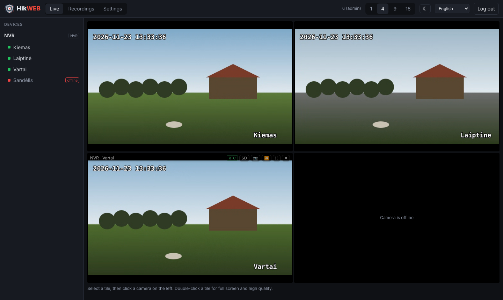
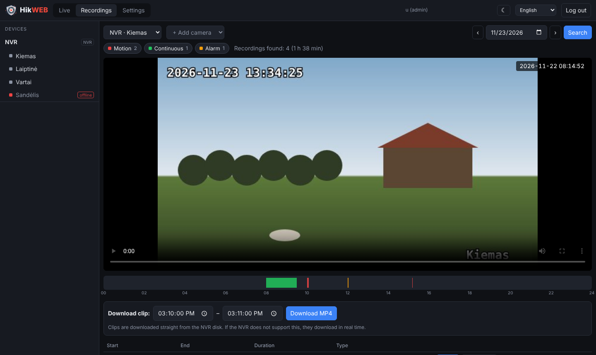
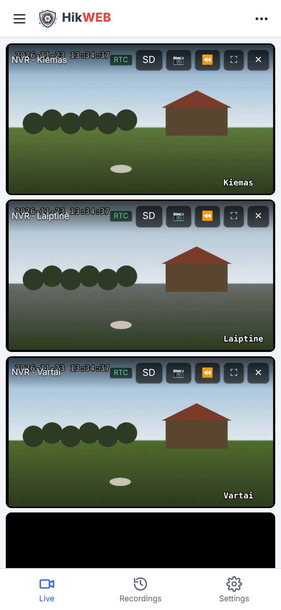
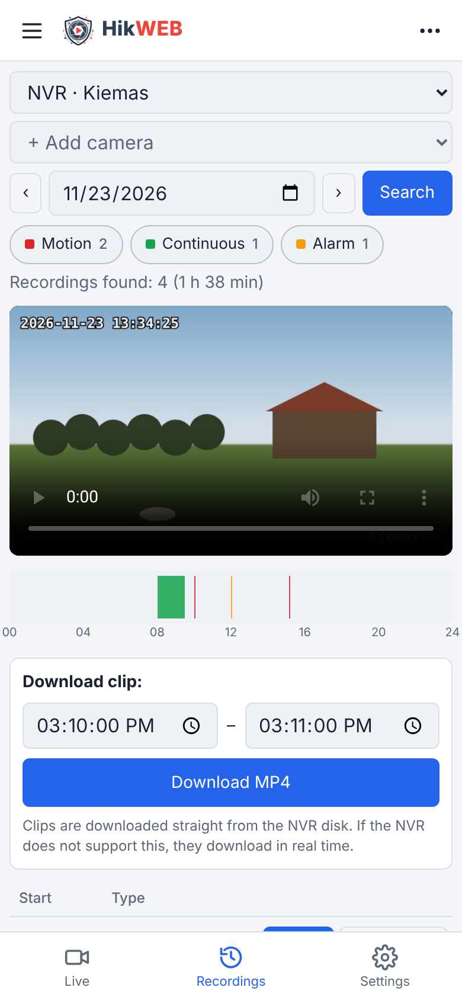

<p align="center">
  
</p>

<p align="center">
  <b>Savo serveryje veikianti Hikvision NVR ir IP kamerų peržiūra naršyklėje.</b><br>
  Tiesioginis vaizdas, įrašai, atsisiuntimas, vartotojai. Veikia bet kurioje naršyklėje ir telefone.<br>
  Be debesijos, be papildinių, be npm priklausomybių.
</p>

<p align="center">
  <a href="#greita-pradžia">Greita pradžia</a> ·
  <a href="#galimybės">Galimybės</a> ·
  <a href="#nustatymai">Nustatymai</a> ·
  <a href="#problemų-sprendimas">Problemų sprendimas</a> ·
  <a href="README.md">English</a>
</p>

---



## Kam to reikia?

Hikvision svetainei reikia naršyklės papildinių, o programėlė jungiasi per debesį.
**HikWeb** veikia bet kuriame mažame Linux kompiuteryje jūsų tinkle: Raspberry Pi, NAS ar Home Assistant serveryje. Ji suteikia greitą, šiuolaikišką sąsają, kuri veikia visose naršyklėse, taip pat iPhone ir Android telefonuose, o kameros lieka neatidarytos internetui.

Kamerų slaptažodžiai niekada nepalieka serverio.

## Galimybės

**Tiesioginis vaizdas**
- 1, 4, 9 arba 16 kamerų tinklelis. Tinklelyje rodomas papildomas srautas, o per visą ekraną – pagrindinis
- **WebRTC** su mažesniu nei 1 s vėlavimu (per [go2rtc](https://github.com/AlexxIT/go2rtc)), o nepavykus automatiškai naudojamas HLS
- Kiekvienos kameros būsena (prisijungusi ar ne). Prie neprisijungusių kamerų programa nebando jungtis
- Momentinė nuotrauka. Veikia ir su kameromis, kurios neturi papildomo srauto

**Įrašai**
- Paros laiko juosta su spalvomis pagal tipą: judesys, nuolatinis, signalas. Įrašus galima filtruoti pagal tipą
- Paspaudus bet kurią laiko juostos vietą, įrašas paleidžiamas nuo to momento. Jau pakrautoje dalyje peršokama iškart
- **Iki 4 kamerų greta**, sinchronizuotai tuo pačiu laiku
- **Miniatiūros** užvedus pelę ant laiko juostos
- **MP4 atsisiuntimas** tiesiai iš NVR disko, gerokai greičiau nei realiu laiku. Jei NVR to nepalaiko, naudojamas atsarginis būdas
- Veikia su NVR įrašais ir kamerų SD kortelėmis

**Administravimas naršyklėje**
- NVR ir kamerų pridėjimas, redagavimas ir šalinimas, ryšio patikra
- Vartotojų rolės: *administratorius* ir *žiūrovas*. Žiūrovui galima leisti matyti tik pasirinktus įrenginius
- Užšifruoti slaptažodžiai (scrypt), apsauga nuo slaptažodžio spėliojimo, automatinis atsijungimas po neveiklumo
- **NVR diskų būsena**: talpa, užimtumas, gedimai, kelių dienų įrašai telpa
- **Kasdienė sveikatos ataskaita** į Telegram ir (arba) webhook (pvz. Home Assistant): kurios kameros neprisijungusios ar neįrašinėjo, diskų problemos, įrašų archyvo ilgis
- Web prievadą, klausymosi adresą, svetainės pavadinimą, numatytąją kalbą ir temą galima keisti neperkraunant programos

**Visur**
- Telefonui pritaikyta sąsaja su apatine skirtukų juosta. Galima įdiegti kaip programėlę (PWA)
- Tamsi, šviesi, mėlyna ir automatinė tema
- Lietuvių, anglų ir ukrainiečių kalbos. Naujų kalbų pridėti nesunku

<table>
  <tr>
    <td></td>
    <td width="22%"></td>
    <td width="22%"></td>
  </tr>
</table>

> Ekrano nuotraukose rodomas imituotas kameros vaizdas.

## Reikalavimai

- Linux serveris tame pačiame tinkle kaip NVR ar kameros (Debian, Ubuntu, Raspberry Pi OS…)
- **Node.js 18+** ir **ffmpeg**
- Hikvision NVR, DVR arba IP kamera su įjungtais ISAPI ir RTSP (tinka beveik visi modeliai nuo maždaug 2015 m.)

## Greita pradžia

### Debian / Ubuntu / Raspberry Pi OS

```bash
git clone https://github.com/ecccentricc/hikweb.git
cd hikweb
sudo bash install.sh
```

Diegimo skriptas įdiegia Node.js ir ffmpeg, nukopijuoja programą į `/opt/hikweb`, sukuria `hikweb` vartotoją ir tarnybą. Pabaigoje jis parodo adresą ir sugeneruotą administratoriaus slaptažodį.
Atsidarykite adresą naršyklėje, prisijunkite ir pridėkite NVR skiltyje **Nustatymai → Kameros ir NVR**.

**Atnaujinimas:**
```bash
cd hikweb && git pull && sudo bash install.sh
```
Jūsų `config.json` failas niekada neperrašomas.

### Rankiniu būdu
```bash
cp config.example.json config.json   # įrašykite vartotojus ir įrenginius
node server.js
```

### Docker
```bash
mkdir config && cp config.example.json config/config.json
docker compose up -d --build
```

## Greitas tiesioginis vaizdas (WebRTC)

```bash
sudo bash /opt/hikweb/install-go2rtc.sh
```
Tada įjunkite **Nustatymai → Sistema → Greitas tiesioginis vaizdas (WebRTC per go2rtc)**.

- go2rtc API pasiekiamas tik iš serverio (`127.0.0.1:1984`).
- Naršyklės turi pasiekti serverio prievadą **8556** (TCP ir UDP). Vietiniame tinkle ar per Tailscale/WireGuard tai veikia be papildomų nustatymų.
- Jei prievadas užimtas: `WEBRTC_PORT=8557 API_PORT=1985 sudo bash install-go2rtc.sh`, o nustatymuose įrašykite `http://127.0.0.1:1985`.

## Nustatymai

Beveik viską galima keisti naršyklėje. Nustatymai saugomi `config.json` faile. Laukų aprašymą rasite [README.md](README.md#configuration).

### Rekomenduojami kamerų ir NVR nustatymai
- **Vaizdo kodekas H.264** pagrindiniam ir papildomam srautui. Išjunkite H.264+, H.265+ ir „Smart Codec“.
- *Network → Advanced → Integration Protocol*: įjunkite **ISAPI**.
- RTSP autentifikacija: `digest` arba `digest/basic`.
- Susikurkite atskirą NVR vartotoją, kuris turi tik peržiūros ir atkūrimo teises.
- Įrenginių slaptažodžiuose venkite simbolių `@ : / ?`.

### Ataskaita į Home Assistant
```yaml
alias: HikWeb ataskaita
triggers:
  - trigger: webhook
    webhook_id: hikweb
    allowed_methods: [POST]
    local_only: true
actions:
  - action: notify.notify
    data:
      title: "{{ trigger.json.title }}"
      message: "{{ trigger.json.message }}"
```
Webhook adresas HikWeb nustatymuose: `http://HOME-ASSISTANT:8123/api/webhook/hikweb`.

Telegram: botą sukursite parašę **@BotFather**. Tada parašykite savo botui bet ką, o pokalbio ID sužinosite parašę **@userinfobot**.

### Programėlė telefone
- **iPhone**: Safari → Bendrinti → *Įtraukti į pradžios ekraną*.
- **Android**: Chrome meniu → *Įdiegti programą* (pilnas įdiegimas veikia tik per HTTPS).

## Saugumas

- **Neatidarykite HikWeb tiesiai į internetą.** Naudokite VPN (Tailscale, WireGuard) arba atvirkštinį tarpinį serverį su HTTPS (Caddy, nginx). Tokiu atveju įjunkite *Saugūs slapukai*.
- Įrenginių slaptažodžiai saugomi tik `config.json` faile (teisės `600`) ir niekada nesiunčiami į naršyklę.

## Problemų sprendimas

| Požymis | Priežastis ir sprendimas |
|---|---|
| `453 Not Enough Bandwidth` | Pasiekta NVR srautų riba. Uždarykite kitas programas (iVMS, Hik-Connect, Home Assistant integracijas), naudokite mažiau langelių, sumažinkite bitų spartą. Daug senų NVR vienu metu leidžia **tik vieną įrašo atkūrimą**. HikWeb tai atpažįsta ir praneša. |
| `Connection refused` prievadui 554 | Užstrigo NVR vaizdo tarnyba arba pasikeitė prievadas. Perkraukite NVR, patikrinkite *Network → Advanced → Port* ir *Illegal Login Lock*. |
| Juodas langelis be klaidos | Kamera siunčia H.265. Perjunkite ją į H.264 arba įrenginiui nustatykite `h265` ar `transcode`. |
| `no decoder found for: none` | Nepalaikomas garso takelis. Programa tai sutvarko automatiškai. Kad nereikėtų laukti, įrenginio nustatymuose nuimkite **Garsas**. |
| `EADDRINUSE` | Prievadas užimtas. Pakeiskite `port` reikšmę `config.json` faile. |
| Prievadas iki 1024 (pvz. 80) | `sudo setcap cap_net_bind_service=+ep $(readlink -f $(which node))` |

Žurnalas: `journalctl -u hikweb -f`. RTSP, go2rtc ir aktyvių srautų būseną rodo **Nustatymai → Sistema → Būsena**.

## Licencija

[MIT](LICENSE)

*Hikvision yra Hangzhou Hikvision Digital Technology Co., Ltd. prekės ženklas. Šis projektas nėra susijęs su Hikvision.*
