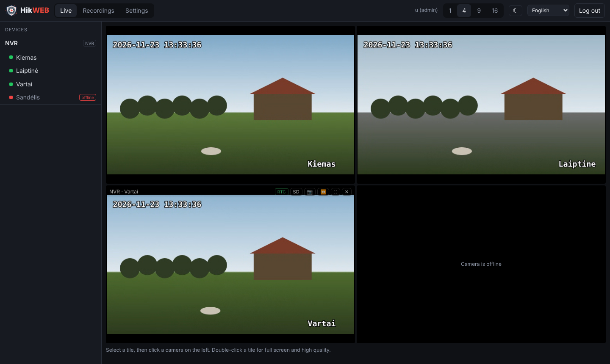
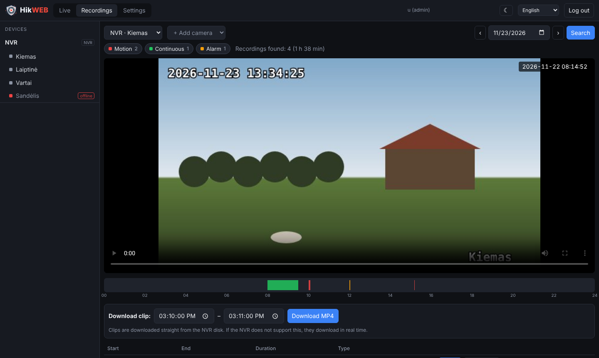
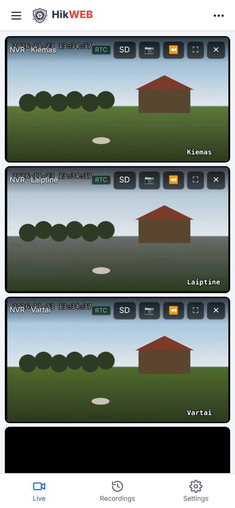
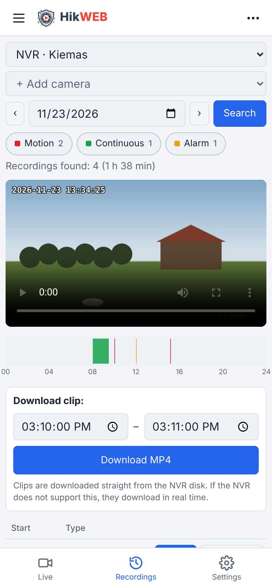
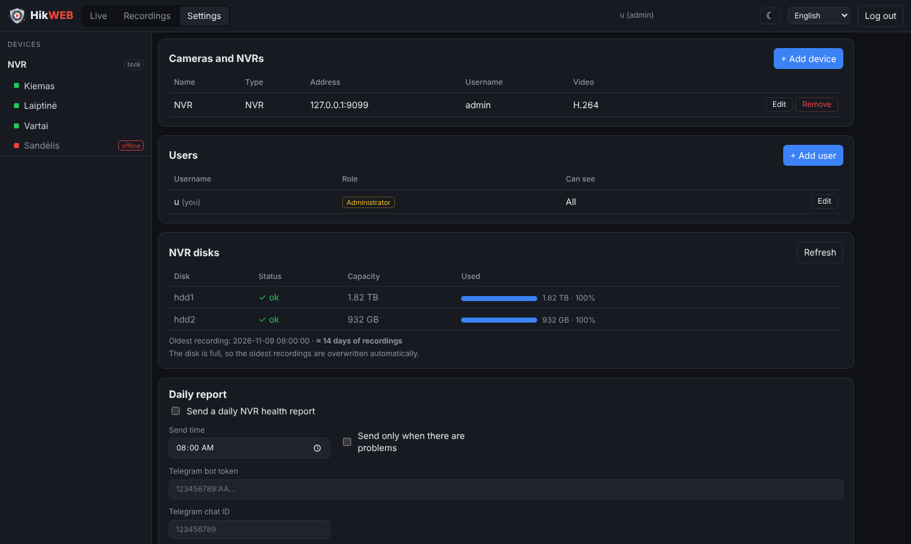

<p align="center">
  
</p>

<p align="center">
  <b>A self-hosted web viewer for Hikvision NVRs and IP cameras.</b><br>
  Live view, recordings playback, clip download, user management – in any browser, on any phone.<br>
  No cloud, no plugins, no npm dependencies.
</p>

<p align="center">
  <a href="#quick-start">Quick start</a> ·
  <a href="#features">Features</a> ·
  <a href="#configuration">Configuration</a> ·
  <a href="#troubleshooting">Troubleshooting</a> ·
  <a href="README.lt.md">Lietuviškai</a>
</p>

---



## Why?

Hikvision's own web interface needs browser plugins, and the mobile app goes through the cloud.
**HikWeb** runs on any small Linux box on your network (a Raspberry Pi, a NAS, a Home Assistant host) and gives you a fast, modern web interface that works in every browser – including iPhone and Android – without exposing your cameras to the internet.

Camera passwords never leave the server.

## Features

**Live view**
- Grid of 1 / 4 / 9 / 16 cameras; sub-stream in the grid, main stream in full screen
- **WebRTC** with less than 1 s delay (via [go2rtc](https://github.com/AlexxIT/go2rtc)), automatic fallback to HLS
- Online / offline status for every camera; offline cameras are not polled
- Snapshot button, works with cameras that have no sub-stream

**Recordings**
- 24-hour timeline per day, colour-coded by type: motion / continuous / alarm (with filter)
- Click anywhere on the timeline to play; instant seeking inside the already loaded part
- **Up to 4 cameras side by side**, synchronised to the same time
- **Thumbnails** when hovering over the timeline
- **MP4 download** straight from the NVR disk (much faster than real time), with automatic fallback
- Works with NVR recordings and camera SD cards

**Administration (in the browser)**
- Add / edit / remove NVRs and cameras, with a connection test
- Users with roles: *administrator* or *viewer*; viewers can be limited to selected devices
- Hashed passwords (scrypt), login rate limiting, automatic logout after inactivity
- **NVR disk status**: capacity, usage, health, how many days of recordings fit
- **Daily health report** to Telegram and/or a webhook (e.g. Home Assistant): which cameras are offline or did not record, disk problems, archive length
- Web port, listen address, site name, default language and theme – all changeable live

**Everywhere**
- Mobile-first layout with bottom navigation; installable as an app (PWA)
- Dark, light, blue and automatic themes
- English, Lithuanian and Ukrainian (easy to add more)

<table>
  <tr>
    <td></td>
    <td width="22%"></td>
    <td width="22%"></td>
  </tr>
</table>



> Screenshots use a simulated camera feed.

## Requirements

- Linux server on the same network as the NVR/cameras (Debian, Ubuntu, Raspberry Pi OS…)
- **Node.js 18+** and **ffmpeg**
- A Hikvision NVR, DVR or IP camera with ISAPI and RTSP enabled (practically all models since ~2015)

## Quick start

### Debian / Ubuntu / Raspberry Pi OS

```bash
git clone https://github.com/ecccentricc/hikweb.git
cd hikweb
sudo bash install.sh
```

The installer installs Node.js and ffmpeg, copies the app to `/opt/hikweb`, creates a `hikweb` system user and service, and prints the address and a generated admin password.
Open it in a browser, log in and add your NVR in **Settings → Cameras and NVRs**.

**Update** later with:
```bash
cd hikweb && git pull && sudo bash install.sh
```
Your `config.json` is never overwritten.

### Manual

```bash
cp config.example.json config.json   # edit users and devices
node server.js
```

### Docker

```bash
mkdir config && cp config.example.json config/config.json
docker compose up -d --build
```
The compose file also starts go2rtc. Both containers use host networking.

## Low-latency live view (WebRTC)

```bash
sudo bash /opt/hikweb/install-go2rtc.sh
```
Then enable **Settings → System → Fast live view (WebRTC via go2rtc)**.

- go2rtc's API listens on `127.0.0.1:1984` only; HikWeb registers the streams itself.
- Browsers must reach the WebRTC port **8556** (TCP + UDP) on the server. On a LAN or over Tailscale/WireGuard this works out of the box.
- If a port is taken: `WEBRTC_PORT=8557 API_PORT=1985 sudo bash install-go2rtc.sh` and set `http://127.0.0.1:1985` in the settings.
- Each tile shows **RTC** or **HLS**. If WebRTC fails (e.g. the browser cannot decode H.265), HLS is used automatically.

## Configuration

Almost everything can be changed in the web interface. Settings are stored in `config.json`:

| Key | Description |
|---|---|
| `port`, `bind` | Web port and listen address (`0.0.0.0` = whole network, `127.0.0.1` = behind a reverse proxy) |
| `users[]` | `username`, `passwordHash` (plain `password` is hashed automatically on first login), `role` (`admin`/`viewer`), optional `devices` list, `noIdleLogout` |
| `devices[]` | `id`, `name`, `type` (`nvr`/`camera`), `host`, `httpPort`, `rtspPort`, `username`, `password`, `video` (`copy`/`h265`/`transcode`), `audio` |
| `siteName`, `language`, `theme` | Shown on the login page; defaults for new visitors |
| `sessionHours`, `idleLogoutMinutes` | Session length; automatic logout (0 = off) |
| `idleSeconds`, `maxStreams`, `maxDownloadMinutes` | Stream limits |
| `fastDownload`, `thumbnails` | Recording features (on by default) |
| `webrtc`, `go2rtcUrl` | WebRTC via go2rtc |
| `report` | Daily report: `enabled`, `time`, `telegramToken`, `telegramChat`, `webhookUrl`, `onlyProblems` |
| `secureCookies` | Enable when served over HTTPS |

### Recommended camera / NVR settings
- **Video encoding: H.264** for both main and sub-stream; disable H.264+/H.265+ and "Smart Codec".
  (H.265 works in Safari and in Chrome/Edge with hardware decoding – set `video: "h265"`; or `transcode` at a high CPU cost.)
- *Network → Advanced → Integration Protocol*: enable **ISAPI**.
- RTSP authentication: `digest` or `digest/basic`.
- Use a dedicated NVR user with *live view* and *playback* rights only.
- Avoid `@ : / ?` in device passwords.

### Daily report to Home Assistant

```yaml
alias: HikWeb report
triggers:
  - trigger: webhook
    webhook_id: hikweb
    allowed_methods: [POST]
    local_only: true
actions:
  - action: notify.notify
    data:
      title: "{{ trigger.json.title }}"
      message: "{{ trigger.json.message }}"
```
Webhook URL in HikWeb: `http://HOME-ASSISTANT:8123/api/webhook/hikweb`.

For Telegram: create a bot with **@BotFather**, send it any message, and get your chat ID from **@userinfobot**.

### Install on a phone
- **iPhone**: open in Safari → Share → *Add to Home Screen*.
- **Android**: Chrome menu → *Install app* (full PWA install requires HTTPS, e.g. Tailscale HTTPS or a reverse proxy).

## Security

- **Do not expose HikWeb directly to the internet.** Use a VPN (Tailscale, WireGuard) or a reverse proxy with HTTPS (Caddy, nginx) – then enable *Secure cookies*.
- Device passwords are stored only in `config.json` (mode `600`) and are never sent to the browser.
- See [SECURITY.md](SECURITY.md) for reporting vulnerabilities.

## Troubleshooting

| Symptom | Cause / fix |
|---|---|
| `453 Not Enough Bandwidth` | The NVR's outgoing stream limit is reached. Close other clients (iVMS, Hik-Connect, Home Assistant integrations), use fewer tiles, lower main-stream bitrate. Many older NVRs allow **only one remote playback at a time** – HikWeb detects this and tells you. |
| `Connection refused` on port 554 | The NVR's RTSP service hung or the port changed – reboot the NVR, check *Network → Advanced → Port*, check *Illegal Login Lock*. |
| Black tile, no error | The camera sends H.265 – switch it to H.264 or set the device codec to `h265`/`transcode`. |
| `no decoder found for: none` | Unsupported audio track – handled automatically; untick **Audio** on the device to skip the retry. |
| `EADDRINUSE` | Port taken – change `port` in `config.json`. |
| Port < 1024 (e.g. 80) | `sudo setcap cap_net_bind_service=+ep $(readlink -f $(which node))` |

Logs: `journalctl -u hikweb -f`. **Settings → System → Status** shows RTSP, go2rtc and active streams.

## How it works

```
Browser ──HTTPS/HTTP──▶ HikWeb (Node.js, server.js)
                          ├─ ISAPI (HTTP digest) ──▶ NVR: channels, status, search, disks, download
                          ├─ ffmpeg: RTSP ──▶ HLS (fMP4, no transcoding) ──▶ browser (hls.js)
                          └─ go2rtc (optional): RTSP ──▶ WebRTC ──▶ browser
```
- Live: `rtsp://NVR/Streaming/Channels/{ch}0{1|2}`; playback: `rtsp://NVR/Streaming/tracks/{ch}01?starttime=…&endtime=…`
- Search: `POST /ISAPI/ContentMgmt/search`; fast download: `/ISAPI/ContentMgmt/download` (MPEG-PS → MP4 remux)
- Single file server, zero npm dependencies; the front-end is plain HTML/CSS/JS.

### Project structure
```
server.js            HTTP server, ISAPI client, ffmpeg/go2rtc management, API
public/              Web interface (index.html, app.js, style.css, i18n.js, theme.js, PWA files)
install.sh           Debian/Ubuntu installer (systemd service)
install-go2rtc.sh    Optional go2rtc installer for WebRTC
docker-compose.yml   HikWeb + go2rtc
config.example.json  Example configuration
```

### Adding a language
Copy the `en` block in `public/i18n.js` and the `en` values in `MSG` in `server.js`, translate, and add the code to `LANG_NAMES` and `LANGS`. Pull requests welcome!

## Contributing

Issues and pull requests are welcome – see [CONTRIBUTING.md](CONTRIBUTING.md).

## License

[MIT](LICENSE)

*Hikvision is a trademark of Hangzhou Hikvision Digital Technology Co., Ltd. This project is not affiliated with or endorsed by Hikvision.*
